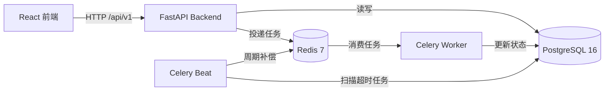

# NotifyHub

基于 **FastAPI + PostgreSQL + Redis + Celery + React** 的异步站内通知平台。

第一版聚焦站内通知：用户注册登录后可以创建通知模板、发送通知、查看通知历史。通知创建后通过 Redis 投递到 Celery Worker 异步处理，支持失败自动重试、超时补偿和严格的用户数据隔离。

## 功能特性

- JWT 认证：注册、登录、获取当前用户信息
- 密码使用 Argon2 哈希，不落库明文
- 通知模板 CRUD，按用户隔离
- 通知创建支持「模板」和「手动输入」两种方式，保存内容快照
- 通知历史分页、按状态筛选、按时间倒序
- Redis + Celery 异步处理，失败指数退避重试
- Celery Beat 周期补偿：重新投递丢失任务、恢复 Worker 崩溃导致的卡死状态
- 所有用户数据查询以 JWT 中的用户 ID 为准，不信任请求参数
- Pytest 自动化测试（认证、模板、通知、权限隔离、Celery 重试与补偿）
- Docker Compose 一键启动完整服务栈

## 架构



通知状态机：

```
pending ──> processing ──> success
   ^              │
   │              ├── 失败且未超过重试预算：retry_count + 1，回到 pending，延迟重试
   │              └── 超过重试预算：failed
   │
   └── 投递失败 / 任务丢失 / Worker 中断：由 Beat 补偿任务重新投递
       （Worker 中断恢复也会消耗一次重试预算）
```

## 目录结构

```
NotifyHub/
├── backend/
│   ├── app/
│   │   ├── main.py              FastAPI 入口、CORS、全局异常处理
│   │   ├── database.py          Engine / Session / Base
│   │   ├── core/                配置、安全、日志、业务异常
│   │   ├── models/              User、NotificationTemplate、Notification
│   │   ├── schemas/             Pydantic 请求/响应模型
│   │   ├── routers/             auth、templates、notifications、依赖注入
│   │   ├── services/            用户、模板、通知、投递业务逻辑
│   │   └── tasks/               Celery 应用、通知处理与补偿任务
│   ├── migrations/              Alembic 迁移（保留 Day 1 历史）
│   ├── tests/                   Pytest 测试
│   ├── requirements.txt
│   ├── requirements-dev.txt
│   ├── Dockerfile
│   ├── alembic.ini
│   └── .env.example
├── frontend/
│   ├── src/
│   │   ├── api/                 Axios 实例与接口封装
│   │   ├── auth/                登录状态 Context
│   │   ├── components/          布局、路由守卫、状态徽章
│   │   ├── pages/               登录、注册、模板、发送、历史、详情
│   │   ├── types/               TypeScript 类型
│   │   ├── App.tsx
│   │   └── index.css
│   ├── nginx.conf
│   ├── Dockerfile
│   └── package.json
├── docker-compose.yml
├── docker-compose.integration.yml   隔离的真实 Redis + Celery 集成栈
├── .env.example
└── README.md
```

## 快速启动（Docker）

Docker Compose **不提供任何默认密钥**：JWT、PostgreSQL、Redis 的密码都必须写入
根目录 `.env`，缺失时 Compose 会直接报错拒绝启动。

```bash
copy .env.example .env      # Windows；macOS/Linux 使用 cp

# 生成 JWT 与 Redis 密码，填入 .env
python -c "import secrets; print(secrets.token_urlsafe(48))"
python -c "import secrets; print(secrets.token_urlsafe(32))"

docker compose up -d --build
docker compose ps
```

`.env` 必填项：

- `JWT_SECRET_KEY`：至少 32 字符；生产环境还会拒绝 `change-me`、`dev-only` 等示例值。
- `POSTGRES_PASSWORD`：新建数据卷时使用强密码；**沿用已有开发数据卷时必须填写该卷初始化时的密码**，否则认证失败。需要轮换时请在数据库中执行 `ALTER USER`，不要删除数据卷。
- `REDIS_PASSWORD`：建议使用 `token_urlsafe` 生成，避免 URL 特殊字符。

默认访问地址：

- 前端：http://localhost:3000
- 后端 API（仅本机）：http://localhost:8000
- API 文档：http://localhost:8000/docs

安全默认值：

- PostgreSQL、Redis、backend 的宿主机端口均只绑定 `127.0.0.1`；外部访问统一经过 frontend Nginx。
- Redis 开启 `requirepass`，backend、worker、beat 使用同一个带密码的 `REDIS_URL`。
- Docker 内部服务通过 Compose 网络域名通信，不受宿主机端口绑定影响。
- `docker-compose.yml` 中不包含任何真实密码。

服务说明：

| 服务 | 作用 |
|---|---|
| postgres | 数据库，数据持久化到 `postgres_data` |
| redis | Celery Broker，AOF 持久化 + 密码认证 |
| migrate | 启动时执行 `alembic upgrade head` |
| backend | FastAPI，仅绑定宿主机 127.0.0.1 |
| worker | Celery Worker |
| beat | Celery Beat，周期补偿任务 |
| frontend | Nginx 托管 React 构建产物，`/api` 反向代理到 backend |

端口被占用时可在 `.env` 中修改 `BACKEND_PORT` / `FRONTEND_PORT` / `POSTGRES_PORT` / `REDIS_PORT`。

演示失败重试：

```bash
# .env 中设置
ALLOW_FAILURE_SIMULATION=true
```

之后发送内容包含 `[FAIL]` 的通知，Worker 会抛错并按指数退避重试，超过最大重试次数后状态变为 `failed`。

同一开关还支持 `[SLOW]`：投递逻辑会故意等待 15 秒，用于验证 Celery soft/hard time limit 与超时处理。该开关默认关闭，生产环境不得开启。

默认软超时为 240 秒，`[SLOW]` 的 15 秒不会触发超时；验证时需临时调小时间限制（例如 `soft=3`、`hard=5`、`PROCESSING_TIMEOUT_SECONDS=30`，并保持 `soft < hard < processing_timeout`）或延长模拟时长。

## 本地开发

### 1. 基础设施

```bash
# 根目录 .env 必须已填写 JWT/PostgreSQL/Redis 密码
docker compose up -d postgres redis
```

### 2. 后端

```bash
cd backend
copy .env.example .env               # 填写 JWT_SECRET_KEY、本地 DB 密码、Redis 密码
../.venv/Scripts/pip install -r requirements-dev.txt
alembic upgrade head
../.venv/Scripts/python.exe -m uvicorn app.main:app --reload --port 8000
```

本地开发连接 `127.0.0.1:5432` / `127.0.0.1:6379`，Redis 需要密码；
`backend/.env` 中的 `JWT_SECRET_KEY` 必须与根目录 `.env` 或 Docker 服务保持一致，否则本地签发的 Token 在 Docker 服务中无法验证（反之亦然）。

### 3. Celery Worker（Windows 必须 `--pool=solo`）

```bash
cd backend
celery -A app.tasks.celery_app:celery_app worker --pool=solo --loglevel=INFO
```

### 4. Celery Beat（补偿任务）

```bash
cd backend
celery -A app.tasks.celery_app:celery_app beat --loglevel=INFO
```

### 5. 前端

```bash
cd frontend
npm install
npm run dev
```

默认开发地址 http://localhost:5173，Vite 将 `/api` 代理到 `http://127.0.0.1:8000`。后端端口不同时：

```bash
VITE_API_PROXY_TARGET=http://127.0.0.1:8010 npm run dev
```

## API 接口

所有业务接口前缀为 `/api/v1`，除注册和登录外都需要 `Authorization: Bearer <token>`。

| 方法 | 路径 | 说明 |
|---|---|---|
| POST | `/auth/register` | 注册 |
| POST | `/auth/login` | 登录，返回 JWT |
| GET | `/auth/me` | 当前用户 |
| POST | `/templates` | 创建模板 |
| GET | `/templates` | 当前用户模板列表 |
| GET | `/templates/{id}` | 模板详情 |
| PUT | `/templates/{id}` | 修改模板 |
| DELETE | `/templates/{id}` | 删除模板 |
| POST | `/notifications` | 创建通知（模板或手动） |
| GET | `/notifications` | 通知历史（page、page_size、status） |
| GET | `/notifications/{id}` | 通知详情 |

## 状态与可靠性设计

- **内容快照**：创建通知时复制模板的 `title` 与 `content`，之后修改或删除模板不影响历史通知。
- **幂等执行**：任务开始前检查状态，`success` / `failed` 直接跳过；`processing` 未超时也会跳过，避免重复消费。
- **失败重试**：失败时 `retry_count` 加 1，未超过重试预算则回到 `pending` 并按指数退避重新投递；超过后置为 `failed` 并记录 `error_message`。
- **投递补偿**：数据库提交成功但 Celery 投递失败时，通知保持 `pending` 并记录错误；Beat 每 60 秒扫描长时间未更新的 `pending` 通知重新投递。
- **Worker 中断恢复**：`processing` 超过 `PROCESSING_TIMEOUT_SECONDS` 视为 Worker 中断；Beat 使用条件 UPDATE 原子增加 `retry_count`，在预算内重置为 `pending`，超预算直接转 `failed`。终态不会被覆盖。
- **Session 隔离**：Celery 任务使用独立数据库 Session，只传递 `notification_id`，不传递 ORM 对象。

### 重试语义

- `retry_count` 表示**已经失败的尝试次数**，包括普通投递失败和 Worker 中断恢复。
- `MAX_NOTIFICATION_RETRIES` 表示**初次执行之外允许的重试次数**。
- `retry_count <= MAX_NOTIFICATION_RETRIES` 时允许下一次尝试；`retry_count > MAX_NOTIFICATION_RETRIES` 时进入 `failed`。
- 因此总执行次数最多为 `MAX_NOTIFICATION_RETRIES + 1` 次（初次执行 + N 次重试）。例如默认值 3 时，最多执行 4 次，最终 `retry_count=4`。
- `MAX_NOTIFICATION_RETRIES=0` 表示不重试，首次失败即 `failed`。
- 普通失败与 Beat 恢复遵循同一套预算，不会因为 Worker 反复崩溃而无限恢复。

### Celery 时间限制与 Worker 丢失

- 默认 `NOTIFICATION_SOFT_TIME_LIMIT_SECONDS=240`，`NOTIFICATION_TIME_LIMIT_SECONDS=280`，且必须满足 `soft < hard < PROCESSING_TIMEOUT_SECONDS(300)`。
- 软超时抛出 `SoftTimeLimitExceeded`，由任务现有的失败处理逻辑记录并进入重试/失败流程。
- 硬超时会终止 Worker 子进程；`task_acks_late=True`、`task_reject_on_worker_lost=True`，消息会被重新投递，Beat 也会在 `PROCESSING_TIMEOUT_SECONDS` 后按预算恢复。
- Docker 使用 Linux prefork pool，时间限制可用。**Windows solo pool 没有 `SIGUSR1`，billiard 会禁用软超时，硬超时也无法可靠终止卡死任务**；Windows 本地开发应依赖 Beat 恢复，而不是时间限制。
- `EXTERNAL_DELIVERY_TIMEOUT_SECONDS=10` 预留给未来邮件/短信/HTTP 渠道的单次网络请求超时；接入时必须在 `services/delivery.py` 中使用并捕获超时异常。

## 用户数据隔离

- 当前用户只从 JWT 的 `sub` 解析，忽略任何请求体/查询参数中的 `user_id`。
- 模板与通知查询均附加 `user_id = current_user.id` 条件。
- 访问其他用户的资源统一返回 `404`，不泄露资源是否存在。
- 使用其他用户的模板创建通知同样返回 `404`。

## 自动化测试

测试使用独立测试数据库，并以 **Alembic `upgrade head` 初始化表结构**（不再使用 `Base.metadata.create_all()`）。测试库名强制以 `_test` 结尾，且不能与开发库同名，否则测试拒绝运行。测试开始前只清空测试库的业务表，不会影响开发库。

未设置 `TEST_DATABASE_URL` 时，会从 `DATABASE_URL` 自动派生 `<database>_test`；本次验收使用独立库 `notifyhub_alembic_test`，原有的 `notifyhub_test` 未被删除。`tests/test_migrations.py` 会校验 `alembic_version` 与 Alembic head 一致，并重复执行 `upgrade head` 验证幂等。

```bash
cd backend
../.venv/Scripts/pip install -r requirements-dev.txt
../.venv/Scripts/python.exe -m pytest -q
```

测试中的登录限流使用 `fakeredis` 内存实现，不依赖本机 Redis；Celery 使用 eager 模式验证任务逻辑，真实 Redis + Worker 链路通过 Docker 冒烟脚本验证。

覆盖内容：

- 注册成功、重复邮箱、弱密码、非法邮箱
- 登录成功、密码错误、用户不存在（统一错误信息）
- 未认证、无效 JWT、有效 JWT
- 登录限流：IP 维度、邮箱维度、窗口过期、成功登录重置、Redis 不可用降级
- 启动配置：缺失/过短/生产默认 JWT 密钥拒绝启动，合法密钥正常启动，ENVIRONMENT 白名单
- 模板 CRUD 与跨用户访问
- 通知创建、模板快照、跨用户访问、分页、状态筛选
- 用户名 strip 后长度校验、纯空格拒绝
- 模板更新显式 null 拒绝、部分字段更新、重复名称 409、回滚
- Celery 任务成功、幂等、重试、超过次数转 failed、超时恢复、补偿重投
- Beat 条件更新：终态不被覆盖、重复补偿只占用一次、pending/processing 竞态保护
- Worker 崩溃恢复消耗重试预算、预算耗尽转 failed、多次崩溃不会无限恢复
- Celery soft/hard time limit 配置校验、`task_reject_on_worker_lost`、acks_late、prefetch

### 真实 Redis + Celery 集成栈

`docker-compose.integration.yml` 使用独立的 PostgreSQL、Redis、API、Worker 和 Beat，不挂载、不连接开发数据库/data 卷：

```bash
# 生成并导出测试密钥（PowerShell 可用 $env:NAME="..."）
export IT_JWT_SECRET=$(python -c "import secrets; print(secrets.token_urlsafe(48))")
export IT_POSTGRES_PASSWORD=$(python -c "import secrets; print(secrets.token_urlsafe(24))")
export IT_REDIS_PASSWORD=$(python -c "import secrets; print(secrets.token_urlsafe(24))")

docker compose -p notifyhub-it -f docker-compose.integration.yml up -d --build
# API: 127.0.0.1:18080
# 测试 PostgreSQL: 127.0.0.1:55432，测试 Redis: 127.0.0.1:56379

docker compose -p notifyhub-it -f docker-compose.integration.yml down
```

该栈使用独立的 `notifyhub_it_test` 数据库、独立 Redis 容器、Linux prefork Worker 和 Beat；清理时使用 `down`，不要使用 `down -v`。开发栈的 `notifyhub` 数据库和 `notifyhub_postgres_data` / `notifyhub_redis_data` 数据卷不受影响。

验收时已在该栈实际验证：
- API 创建通知 → Redis 队列 → Worker 消费 → PostgreSQL 更新 → API 查询 success
- `[FAIL]` 通知重试后最终 failed，`retry_count` 正确
- 构造超时 processing 后，现有恢复任务消耗预算并恢复/转 failed
- Worker 容器强杀后，恢复任务重新入队，最终按预算 failed

### 端到端冒烟脚本

服务启动后，可直接运行仓库中的冒烟脚本验证完整链路（注册、登录、模板、通知、Celery 处理、隔离、分页）：

```bash
python scripts/smoke_test.py --base-url http://localhost:8000
# 通过前端 Nginx 验证，并演示失败重试（需 ALLOW_FAILURE_SIMULATION=true）
python scripts/smoke_test.py --base-url http://localhost:3000 --include-failure
```

## 演示流程

1. 注册并登录。
2. 创建通知模板。
3. 使用模板发送通知，观察状态从 `pending/processing` 变为 `success`。
4. 在通知详情或历史页确认内容快照。
5. 退出登录后直接访问 `/notifications`，会被重定向到登录页。
6. 注册第二个账号，确认看不到第一个账号的数据。
7. 开启 `ALLOW_FAILURE_SIMULATION=true`，发送内容包含 `[FAIL]` 的通知，观察重试次数和最终 `failed` 状态。

## 环境变量

| 变量 | 默认值 | 说明 |
|---|---|---|
| `ENVIRONMENT` | `development` | 仅允许 `development` / `test` / `production` |
| `DATABASE_URL` | 无密码示例 | 本地 SQLAlchemy 连接串，密码必须来自环境变量/.env |
| `TEST_DATABASE_URL` | 空 | 可选；为空时自动派生 `*_test` 数据库 |
| `REDIS_URL` | 无密码示例 | Celery Broker，Docker 中含 `REDIS_PASSWORD` |
| `JWT_SECRET_KEY` | **无默认值** | **必填**，至少 32 字符；生产拒绝示例值 |
| `ACCESS_TOKEN_EXPIRE_MINUTES` | `60` | Token 有效期 |
| `POSTGRES_PASSWORD` / `REDIS_PASSWORD` | **无默认值** | Docker Compose 必填 |
| `TRUST_PROXY_HEADERS` | `false`；Compose 为 `true` | 仅在可信反向代理后开启 |
| `LOGIN_RATE_LIMIT_IP_MAX` | `20` | IP 窗口内最大失败次数 |
| `LOGIN_RATE_LIMIT_IP_WINDOW` | `60` | IP 限流窗口（秒） |
| `LOGIN_RATE_LIMIT_EMAIL_MAX` | `5` | 邮箱窗口内最大失败次数 |
| `LOGIN_RATE_LIMIT_EMAIL_WINDOW` | `300` | 邮箱限流窗口（秒） |
| `MAX_NOTIFICATION_RETRIES` | `3` | 初次执行之外允许的重试次数；总尝试最多 N+1 次 |
| `RETRY_BACKOFF_BASE_SECONDS` | `5` | 指数退避基数 |
| `PROCESSING_TIMEOUT_SECONDS` | `300` | 处理超时时间；Beat 据此恢复 Worker 中断 |
| `DISPATCH_STALE_SECONDS` | `120` | 待投递通知的补偿阈值 |
| `NOTIFICATION_SOFT_TIME_LIMIT_SECONDS` | `240` | Celery 软超时，必须小于硬超时 |
| `NOTIFICATION_TIME_LIMIT_SECONDS` | `280` | Celery 硬超时，必须小于处理超时 |
| `EXTERNAL_DELIVERY_TIMEOUT_SECONDS` | `10` | 预留：外部渠道单次请求超时 |
| `ALLOW_FAILURE_SIMULATION` | `false` | 开发/演示：`[FAIL]` 失败、`[SLOW]` 慢投递 |
| `CORS_ORIGINS` | 本地前端地址 | 允许的跨域来源 |

## 登录限流

- 同时按 **IP** 与 **邮箱** 统计失败次数：
  - 同一 IP 60 秒内失败 20 次后，第 21 次起返回 `429`。
  - 同一邮箱 300 秒内失败 5 次后，第 6 次起返回 `429`。
- 限流检查在密码校验之前执行，避免消耗 Argon2 CPU。
- 返回 `429` 时携带 `Retry-After` 秒数；被限流的请求不会继续延长窗口。
- 登录成功只清除邮箱维度失败计数，IP 维度保留到窗口过期。
- 窗口过期后自动恢复，不会永久锁定账号。
- Redis 不可用时登录接口返回 `503`（fail-closed），Redis 连接/读取超时为 0.5 秒，不会无限等待。
- Docker 中 Nginx 会**覆盖** `X-Forwarded-For`，backend 仅在 `TRUST_PROXY_HEADERS=true` 时信任该头，防止客户端伪造 IP。

## 安全说明

- 密码仅保存 Argon2 哈希。
- JWT 密钥没有默认值；缺失、过短时应用拒绝启动，`ENVIRONMENT` 必须属于白名单。
- 生产环境拒绝包含 `change-me`、`dev-only`、`placeholder` 等标记的 JWT 密钥。
- 登录失败不区分「邮箱不存在」与「密码错误」。
- 登录接口具备 Redis 限流；Redis 故障时 fail-closed。
- PostgreSQL、Redis、backend 的宿主机端口默认只绑定 `127.0.0.1`；Redis 开启密码认证。
- 全局异常处理不会把堆栈、数据库密码等敏感信息返回给客户端。
- `.env` 已被 `.gitignore` 忽略；仓库中只保留空的 `.env.example`。

## 已知限制

- 第一版仅站内通知，不接入真实邮件/短信渠道。
- 通知处理是 at-least-once：任务端使用行锁与状态机，补偿端使用条件 UPDATE，但仍无法保证外部渠道的“恰好一次”；接入邮件/短信时需要业务幂等键。
- Redis 同时作为 Broker 与限流存储，生产可考虑独立实例与持久化策略。
- 未实现刷新 Token、登出黑名单；JWT 登出后仍可能有效到过期。
- 限流是单 Redis 固定窗口，未实现跨多 Redis 的精确全局配额。
- Windows solo pool 不支持可靠的 soft/hard time limit；卡死任务依赖 Beat 恢复。极端情况下，Windows 上恢复后的卡死任务若再次运行，任务终态写入仍是普通 ORM 更新，未改为条件 UPDATE，可能与补偿结果竞争。
- 自动化测试中 Celery 使用 eager 模式；真实 Redis/Worker 链路由 Docker 冒烟验证。

## 后续计划

- Day 7：补充前端组件测试/E2E、接入结构化日志与监控、完善 CI。
- 增加通知已读状态、批量发送、WebSocket 实时推送。
- 接入邮件/短信渠道时扩展 `services/delivery.py`，任务层无需改动。
